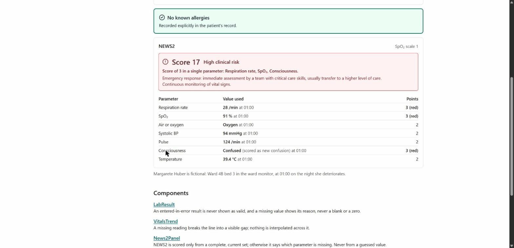

# wardkit

Not a medical device and not for clinical use. These components are reference implementations for developers. Clinical rules are cited so you can check them, not so you can rely on them.

React components that take FHIR R4 resources as props and render them by the clinical rules they cite.



## Install

Each component installs on its own with the shadcn CLI, into a React project with Tailwind and the shadcn `cn` helper:

```bash
npx shadcn@latest add https://raw.githubusercontent.com/Henrycarto/wardkit/main/public/r/lab-result.json
npx shadcn@latest add https://raw.githubusercontent.com/Henrycarto/wardkit/main/public/r/vitals-trend.json
npx shadcn@latest add https://raw.githubusercontent.com/Henrycarto/wardkit/main/public/r/news2-panel.json
npx shadcn@latest add https://raw.githubusercontent.com/Henrycarto/wardkit/main/public/r/allergy-banner.json
npx shadcn@latest add https://raw.githubusercontent.com/Henrycarto/wardkit/main/public/r/patient-banner.json
```

Files land in `components/wardkit/` and `lib/wardkit/`. The only runtime dependencies are React and lucide-react; FHIR types come from `@types/fhir` as a dev dependency. Charts are plain SVG.

## Example

```tsx
import type { Observation } from 'fhir/r4';
import { LabResult } from '@/components/wardkit/lab-result';

const potassium: Observation = {
  resourceType: 'Observation',
  status: 'final',
  code: { coding: [{ system: 'http://loinc.org', code: '2823-3', display: 'Potassium [Moles/volume] in Serum or Plasma' }], text: 'Potassium' },
  effectiveDateTime: '2026-10-21T00:40:00+02:00',
  valueQuantity: { value: 6.9, unit: 'mmol/L', system: 'http://unitsofmeasure.org', code: 'mmol/L' },
  interpretation: [{ coding: [{ system: 'http://terminology.hl7.org/CodeSystem/v3-ObservationInterpretation', code: 'HH' }] }],
  referenceRange: [{ low: { value: 3.5, unit: 'mmol/L' }, high: { value: 5.1, unit: 'mmol/L' } }],
};

export default function Result() {
  return <LabResult observation={potassium} timeZone="Europe/Vienna" />;
}
```

This renders "6.9 mmol/L" with a "Critically high" flag (text and icon, not only colour) and the range "3.5 to 5.1 mmol/L".

## Components

| Component | Takes | Rule it enforces |
|---|---|---|
| `LabResult` | `Observation` | The flag comes only from `interpretation` (H, L, HH, LL, A, N). `preliminary` is marked, `amended` and `corrected` are marked as changed, `entered-in-error` is never shown as a valid result, and a `dataAbsentReason` is shown in place of a value, never a blank or a zero. |
| `VitalsTrend` | `Observation[]` | A missing reading, a `dataAbsentReason` or an entered-in-error reading breaks the line into a visible gap. Nothing is interpolated across a gap. Mixed codes or units are refused. |
| `News2Panel` | `Observation[]` | NEWS2 (RCP 2017) from the latest reading of each parameter, read by LOINC code. A missing, stale or unreadable parameter makes the score incomplete and is named. Never scored from a guessed value; room air is never assumed. SpO2 scale 2 only when the caller turns it on. Rounded values are shown next to what was recorded. |
| `AllergyBanner` | `AllergyIntolerance[]` | "No known allergies" only when a resource records it with a no-known code (SNOMED CT 716186003 and the six concepts under it, or the IPS absent-unknown codes). An empty list shows "No allergy information recorded", which looks different. `entered-in-error` is hidden, `refuted` is not shown as an allergy. |
| `PatientBanner` | `Patient` | Uses the `official` name. Shows date of birth with age, administrative gender and the main identifier with its system. Handles a missing or partial birth date and a deceased patient (`deceasedBoolean` or `deceasedDateTime`). |

Every component page on the docs site has a live example, the props, and each rule with its source. The NEWS2 page lists every LOINC code read; the allergy page lists every no-known code.

## Sources

- Royal College of Physicians. [National Early Warning Score (NEWS) 2](https://www.rcp.ac.uk/improving-care/resources/national-early-warning-score-news-2/). 2017.
- HL7 FHIR R4: [Observation](https://hl7.org/fhir/R4/observation.html), [Vital signs profiles](https://hl7.org/fhir/R4/observation-vitalsigns.html), [AllergyIntolerance](https://hl7.org/fhir/R4/allergyintolerance.html), [Patient](https://hl7.org/fhir/R4/patient.html).
- HL7 Terminology: [v3 ObservationInterpretation](https://terminology.hl7.org/CodeSystem-v3-ObservationInterpretation.html), [DataAbsentReason](https://hl7.org/fhir/R4/valueset-data-absent-reason.html).
- HL7 International Patient Summary: [Allergies and Intolerances value set, 2.0.1](https://hl7.org/fhir/uv/ips/STU2/ValueSet-allergies-intolerances-uv-ips.html) and [Absent or Unknown Allergies, 1.1.0](https://hl7.org/fhir/uv/ips/STU1.1/ValueSet-absent-or-unknown-allergies-uv-ips.html).
- LOINC 2.82 and SNOMED CT International 2025-02-01, codes checked through the HL7 terminology server (tx.fhir.org).

## Tests

```bash
npm install
npm test                    # Vitest + Testing Library, axe on every component
npm run test:a11y           # axe in Chromium on every docs page, light and dark, desktop and phone (needs npm run build)
npm run validate:fixtures   # official HL7 validator 7.0.2 on every fixture (needs Java 17+)
npm run typecheck
npm run lint
```

Each clinical rule above has its own test: every NEWS2 band boundary and risk band, each interpretation code, each status, gap handling, the difference between "no known allergies" and "not recorded", and a deceased patient. The fixtures in `fixtures/` are hand-written synthetic FHIR R4 resources; every patient in them is fictional. CI runs all of the above, plus the registry build and the docs build.

## Known limitations

- Trailing zeros can be lost. FHIR decimals carry their precision: a value or range limit of 2.0 is not the same as 2. `JSON.parse` turns both into the JavaScript number 2, so the components display "2" where the resource said "2.0". Keeping the precision would need the original JSON text or a decimal-preserving parser; the components do not do that yet.

## Docs site

```bash
npm run dev
```

## Licence

MIT
