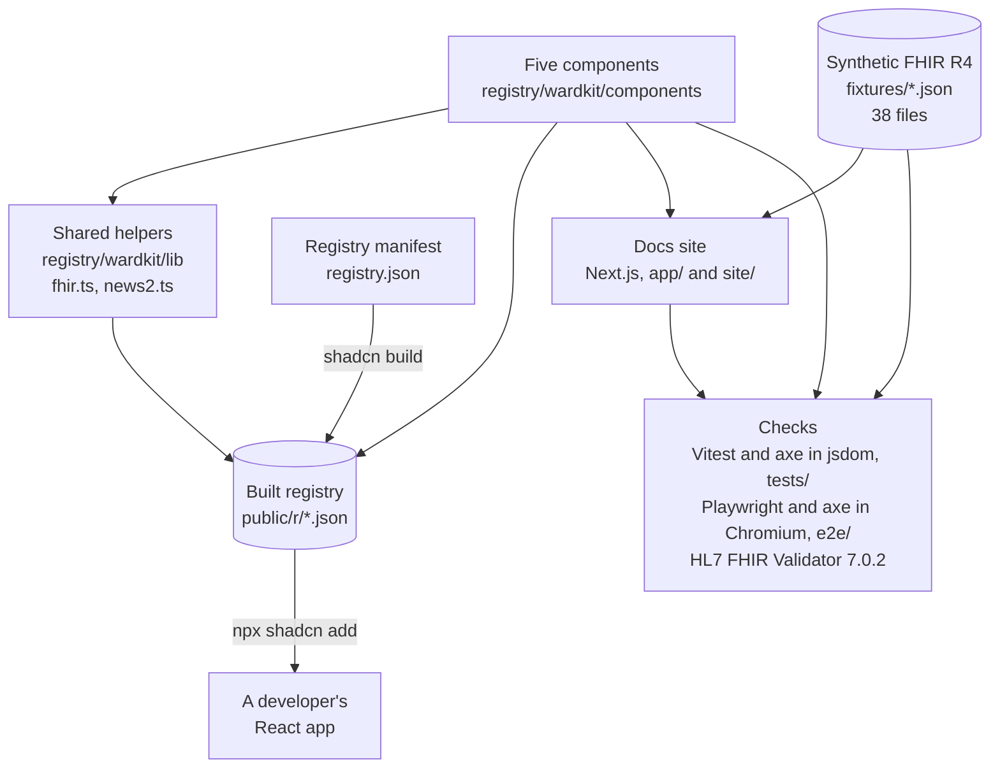

# wardkit, explained

This is a plain-language guide to what wardkit is, why it exists and how it is built. You do not need a background in healthcare or software to follow it. Technical terms are explained the first time they appear, and every term is in the [glossary](#glossary) at the end. For a longer explanation of the health IT standards mentioned here, see the [Health IT primer](https://github.com/Henrycarto/passayge/blob/main/docs/HEALTH_IT_PRIMER.md).

## In one sentence

wardkit is a small set of building blocks for hospital software screens that take standard health data and show it by written clinical rules, so a screen never shows a guess, a hidden error or an empty space as if it were a fact.

## In one paragraph

Hospital software increasingly exchanges data in FHIR (Fast Healthcare Interoperability Resources), a web standard in which each lab value, vital sign, allergy or patient is a small JSON document with an agreed shape. But receiving correct data is only half the job: the screen that shows it can still mislead. It can draw a line through a missing heart rate reading, show "no known allergies" when nobody ever asked, show a lab value that was later marked as entered by mistake, or calculate an early warning score from incomplete measurements. wardkit is five React components (reusable pieces of a web page) that each take FHIR R4 resources as input and show them by rules that are written down and cited: `LabResult`, `VitalsTrend`, `News2Panel`, `AllergyBanner` and `PatientBanner`. A developer copies them into their own project with one command, the same way the popular shadcn/ui component collection works. A documentation website shows each component with live examples, its inputs and each rule with its source. Every rule has a test, every example record is checked by the official HL7 FHIR validator, and every page is checked for accessibility. It is not a medical device and not for clinical use: it is a reference for developers.

## The real-world problem

### A short story

Margarete Huber is 71 and on Ward 4B after an operation. (She is fictional, like every patient in wardkit's example data.) On the night of 20 October 2026 her heart rate is measured every hour by a clip on her finger. At 22:00 the clip has slipped off, so the monitor records "probe off, no valid reading". From 23:00 her heart rate climbs: 90, 104, 112, 118, and 124 beats per minute at 01:00. At 02:00 someone types 160 into her record by mistake and marks it as entered in error. Nobody measures her between 03:00 and 06:00.

At 01:00 the night nurse, Jonas Berger (also fictional), takes a full set of observations: breathing 28 per minute, oxygen saturation 91% on 2 litres of oxygen, blood pressure 94/58, pulse 124, temperature 39.4 °C, and she is confused.

Four things on the nurse's screen could mislead him:

1. **The heart rate chart.** If the chart joins the dots, the probe-off at 22:00 disappears and the 160 entered in error at 02:00 shows as a spike. The three empty hours look like a smooth line.
2. **The early warning score.** NEWS2 (National Early Warning Score 2) turns seven measurements into points. If one measurement is missing and the software quietly assumes "normal" or "room air", the score is too low, and the response it calls for is too slow.
3. **The allergy banner.** If nobody has recorded allergies yet, an empty list is not the same as "no known allergies". A screen that shows a green "none" for both invites a dangerous assumption.
4. **A lab result.** A potassium value that was entered in error, or a CRP of "<5 mg/L" shown as "5 mg/L", or a value with a flag worked out by the screen instead of by the laboratory, all look like facts and are not.

### What goes wrong

- **Standards define the data, not the display.** FHIR says what a field means (for example `entered-in-error` or `dataAbsentReason`), but each app decides how to show it, and each makes its own mistakes.
- **Absent and empty look the same.** In code, "no value" and "zero" and "nothing recorded" are easy to mix up. In a hospital they mean very different things.
- **Scores are easy to compute wrongly.** NEWS2's chart is simple, but deciding which reading to use, how old it may be, and what to do when one is missing is not on the chart.
- **Every team rebuilds the same screens.** A patient banner or a lab result card is written again in every project, often without tests for the awkward cases.

wardkit addresses these: each component enforces a short list of named rules, cites the source of each, and has a test for each awkward case.

## The healthcare background you need

Short definitions follow. The [Health IT primer](https://github.com/Henrycarto/passayge/blob/main/docs/HEALTH_IT_PRIMER.md) explains each one in more depth.

**FHIR and FHIR R4.** FHIR is a standard from HL7 International for exchanging health data over the web. Data is split into resources, each a small JSON document with a fixed shape: a Patient, an Observation (one measurement), an AllergyIntolerance. R4 is release 4 (version 4.0.1), the version most systems use today and the one wardkit uses. Think of standard shipping containers: any port can handle them because the shape is agreed in advance.

**Observation.** The FHIR resource for one measurement or result: a lab value, a heart rate, a level of consciousness. It has a code saying what was measured, a time, a value with a unit, a status, and optionally a reference range and an interpretation flag. Some Observations, such as a blood pressure, carry several values in `component` parts (systolic and diastolic). It is like one line on a lab report, with all its small print attached.

**Status and entered-in-error.** Every Observation has a status: `registered` (ordered, no result yet), `preliminary`, `final`, `amended` or `corrected` (changed after it was first reported), `cancelled`, or `entered-in-error` (it should never have existed). An entered-in-error record stays in the system so the history is honest, but it must not be shown as a result. It is like a crossed-out line in a paper record: you can see it was there, and you know not to use it.

**dataAbsentReason.** A FHIR field that says why a value is missing: the probe was off, the patient refused, an error occurred. A missing value with a reason is information; a blank is not. Think of a school report that says "absent, ill" instead of a 0.

**Reference range and interpretation.** The reference range is the usual range for a test, for example potassium 3.5 to 5.1 mmol/L. The interpretation is the laboratory's own flag: H (high), L (low), HH or LL (critically high or low), A (abnormal), N (normal), from the HL7 code list "v3 ObservationInterpretation". The laboratory may know things the screen does not (age, sex, the method used), so the flag should come from the lab, not be recomputed by the screen.

**Comparator.** A FHIR value can carry `<` or `>`, meaning "below" or "above" a limit the lab can measure. "<5 mg/L" means "too low to measure precisely", which is not the same as 5.

**Codes: LOINC, SNOMED CT and UCUM.** LOINC is a catalogue of codes for tests and measurements, so that heart rate is `8867-4` everywhere. SNOMED CT is a large clinical vocabulary; for example `716186003` means "No known allergy". UCUM is the standard for units, so "beats per minute" is written `/min` and degrees Celsius `Cel`. Codes are like barcodes on groceries: the label can be in any language, the barcode means the same thing everywhere.

**Vital signs and the FHIR vital signs profiles.** Vital signs are the basic bedside measurements: breathing rate, oxygen saturation (SpO2, the percentage of oxygen in the blood, measured by a finger clip), blood pressure, heart rate, temperature. FHIR R4 defines vital signs profiles: extra rules that say, for example, a heart rate Observation must use LOINC `8867-4` and the unit `/min`.

**NEWS2 (National Early Warning Score 2).** A bedside score published by the Royal College of Physicians in London in 2017. Seven parameters (breathing rate, SpO2, air or oxygen, systolic blood pressure, pulse, consciousness, temperature) each get 0 to 3 points. A total of 0 to 4 is low risk, 5 to 6 medium, 7 or more high, and any single parameter scoring 3 raises the risk to at least "low-medium". Each band comes with a response, from routine monitoring to an emergency team. Think of a smoke detector with stages. Whether NEWS2 is used in Austrian hospitals is not confirmed.

**SpO2 scale 2.** Some patients with chronic lung disease (hypercapnic respiratory failure, where carbon dioxide builds up) are meant to run at a lower oxygen saturation, 88 to 92%. NEWS2 has a second SpO2 scale for them, which a clinician must decide on. Using it for the wrong patient would hide a real drop in oxygen.

**Consciousness and AVPU.** NEWS2 scores consciousness with ACVPU: Alert, new Confusion, responds to Voice, responds to Pain, Unresponsive. Only Alert scores 0; everything else scores 3. LOINC has answer codes for these, which wardkit reads.

**AllergyIntolerance and "no known allergies".** The FHIR resource for one allergy or intolerance, with the substance, how sure it is (`verificationStatus`: confirmed, unconfirmed, refuted, entered-in-error), whether it is current (`clinicalStatus`: active, inactive, resolved), how dangerous it is (`criticality`) and the reactions. "No known allergies" is recorded as an AllergyIntolerance too, with a special code. An empty list means nobody recorded anything. The difference is like a form with "None" ticked versus a form left blank.

**IPS (International Patient Summary).** An HL7 standard for a short summary of a patient's key data, meant to travel across borders. It defines its own codes for "no known allergies" and "no information about allergies", which wardkit reads alongside the SNOMED CT ones.

**Patient banner.** The strip at the top of a clinical screen that says whose record this is: name, date of birth and age, gender, and a hospital number. Its job is to prevent the wrong-patient error. FHIR names have a `use` (official, usual, maiden, old), and identifiers have a `system`, a web address that says which numbering scheme the number belongs to.

**HL7 FHIR Validator.** The official command-line tool from HL7 that checks a FHIR resource against the standard, its profiles and its code lists. It reports errors, warnings and information messages.

## What it does, step by step

Here is one full journey, from a developer adding a component to the screen the nurse sees, using the example data for Margarete Huber at 01:00.

1. **A developer adds a component.** In their own React project, they run `npx shadcn@latest add https://raw.githubusercontent.com/Henrycarto/wardkit/main/public/r/news2-panel.json`. The shadcn tool reads that JSON file (built from [registry.json](../registry.json)) and copies the source code into the project: the component into `components/wardkit/`, the helpers it needs into `lib/wardkit/` (here [fhir.ts](../registry/wardkit/lib/fhir.ts) and [news2.ts](../registry/wardkit/lib/news2.ts)), and shadcn's own `cn()` helper if it is not there yet. It also adds `lucide-react` for icons and `@types/fhir` for typed FHIR resources. The code now belongs to the project; there is no wardkit package to update.
2. **The app passes FHIR data.** The app fetches Margarete's latest Observations from wherever it gets them (wardkit does not fetch anything) and writes `<News2Panel observations={latest} now="2026-10-21T01:00:00+02:00" maxAgeMinutes={60} timeZone="Europe/Vienna" />`. The caller must say what "now" is and how old a reading may be.
3. **The panel finds each parameter by its code.** `news2FromObservations()` looks for each parameter by LOINC code: `9279-1` breathing rate, `2708-6` or `59408-5` SpO2, `8480-6` systolic pressure (alone or inside a `85354-9` blood pressure panel), `8867-4` pulse, `8310-5` temperature, `67775-7` or `80288-4` consciousness, and `3151-8`, `3150-0` or `88658-0` for air or oxygen. It ignores records whose status is not final, amended, corrected or preliminary.
4. **It checks the most recent reading of each.** Only the latest reading counts. It is refused, and the parameter is marked missing with the reason, if it has no time, is timed after "now", is older than 60 minutes, has a `dataAbsentReason`, has a comparator, or has a unit the panel does not support. An older good reading never stands in for a newer failed one.
5. **It rounds and scores.** Values are rounded half up to whole numbers (temperature to one decimal), because the chart's bands are whole numbers. Margarete's readings give: breathing 28 (3 points), SpO2 91 (3), oxygen at 2 L/min (2), systolic 94 (2), pulse 124 (2), Confused (3, labelled "scored as new confusion"), temperature 39.4 (2).
6. **It shows the result.** Score 17, "High clinical risk", "Score of 3 in a single parameter: Respiration rate, SpO₂, Consciousness", and the response: "Emergency response: immediate assessment by a team with critical care skills, usually transfer to a higher level of care." and "Continuous monitoring of vital signs." A table below lists each parameter, the value used, its time and its points. Colour is never the only signal: every band has text and an icon.
7. **If something were missing, it says so.** Had the oxygen record been absent, the panel would show "Incomplete: no score", list "Air or oxygen" as missing with the reason "No air or oxygen record (room air is not assumed)", and still point out the parameters already scoring 3, because each of those alone needs an urgent response.
8. **The other components follow the same idea.** `VitalsTrend` draws Margarete's heart rate overnight as separate line pieces, with a hatched mark at 22:00 (probe off) and at 02:00 (entered in error), and, with `maxGapMinutes={120}`, a hatched span from 03:00 to 06:00. `AllergyBanner` shows a green "No known allergies" only because a record with code `716186003` says so. `PatientBanner` shows "HUBER, Margarete Anna", born 14 Mar 1955 (71 years), "Gender (administrative): Female", and the identifier W4B-000317 with its system.
9. **The docs site shows all of it.** The Next.js site in [app/](../app) has an overview page and one page per component, each with the install command, usage, live examples built from the same JSON test data in [fixtures/](../fixtures), a table of inputs, and the numbered clinical rules with links to their sources ([site/catalogue.ts](../site/catalogue.ts)). It is published at https://wardkit.vercel.app.

## How it is built

There is no server and no database. wardkit is source code that ends up inside someone else's app, plus a static website that demonstrates it.

### The parts

| Part | What it is | Why it exists | Talks to |
|---|---|---|---|
| **FHIR helpers** ([registry/wardkit/lib/fhir.ts](../registry/wardkit/lib/fhir.ts)) | Small functions: find a code in a `CodeableConcept` (`hasCode()`, `codeIn()`), get readable text (`conceptText()`), format a quantity with its comparator (`formatQuantity()`), find when an Observation applies (`effectiveTime()`), format dates in a time zone, and round half up (`roundHalfUp()`). | Every component reads FHIR the same way, from one tested place. Codes are matched exactly by system and code; there is no terminology server. | Used by every component. |
| **NEWS2 logic** ([registry/wardkit/lib/news2.ts](../registry/wardkit/lib/news2.ts)) | Two layers. Pure scoring: one function per parameter band (`respRatePoints()`, `spo2Scale1Points()`, `spo2Scale2Points()` and so on) and `score()`, which adds up the points and picks the risk band and response. Then `news2FromObservations()`, which reads FHIR Observations and decides, per parameter, whether there is a usable value. | Keeps the clinical arithmetic separate from the data handling, so each can be tested alone. The comment says the scoring is ported from the author's ward monitor project. | `News2Panel`. |
| **LabResult** ([registry/wardkit/components/lab-result.tsx](../registry/wardkit/components/lab-result.tsx)) | One lab result card: name, time, value and unit, reference range, status badge and interpretation flags. Handles panels whose values sit in components. | Lab results are the most common clinical display and have many awkward states. | FHIR helpers. |
| **VitalsTrend** ([registry/wardkit/components/vitals-trend.tsx](../registry/wardkit/components/vitals-trend.tsx)) | `trendModel()` turns Observations into line segments and gaps; the component draws them as plain SVG with a shaded reference band and a table of every reading. | A chart that joins every point hides missing and wrong readings. | FHIR helpers. |
| **News2Panel** ([registry/wardkit/components/news2-panel.tsx](../registry/wardkit/components/news2-panel.tsx)) | Shows the score, risk band and response, or "Incomplete: no score" with what is missing; and a table of each parameter. | The score must never look complete when it is not. | NEWS2 logic. |
| **AllergyBanner** ([registry/wardkit/components/allergy-banner.tsx](../registry/wardkit/components/allergy-banner.tsx)) | `summariseAllergies()` sorts records into active, inactive, "no known" statements, "no information" and refuted, and finds conflicts; the banner then shows one of three clearly different looks: red (allergies), green (no known allergies recorded), dashed grey with a question mark (nothing recorded). | "None" and "not asked" must never look alike. | FHIR helpers. |
| **PatientBanner** ([registry/wardkit/components/patient-banner.tsx](../registry/wardkit/components/patient-banner.tsx)) | Picks the name (`pickName()`) and identifier (`pickIdentifier()`), works out age (`ageOn()`), and shows a "Deceased" badge when needed. | Identifying the right patient is the first safety check on any screen. | FHIR helpers. |
| **Registry manifest** ([registry.json](../registry.json)) | Lists seven registry items: the two helper files and the five components, each with its dependencies and the folder it lands in. | It is what the shadcn tool reads to know what to copy. | `shadcn build` turns it into [public/r/](../public/r). |
| **Built registry** ([public/r/](../public/r)) | One JSON file per item with the source code inside, served from GitHub's raw file address. | So `npx shadcn add <url>` works without a package registry. | The shadcn tool in a developer's project. |
| **Fixtures** ([fixtures/](../fixtures)) | 38 hand-written JSON files: 11 allergy records, 14 lab results, 5 patients, 4 blood pressure Observations and 4 Bundles (collections) of vital signs. All patients are fictional. | One set of data for tests, docs examples and validation, so all three check the same thing. | Tests, docs site ([site/fixtures.ts](../site/fixtures.ts)), validator. |
| **Docs site** ([app/](../app), [site/](../site)) | Next.js pages, all built as static pages. [site/catalogue.ts](../site/catalogue.ts) holds each component's summary, inputs and rules with sources, so the overview and the pages always agree. | To see the components and read the rules. | Components and fixtures. |
| **Validation script** ([scripts/validate-fixtures.mjs](../scripts/validate-fixtures.mjs)) | Downloads the HL7 validator 7.0.2 into `.cache/` if needed, runs it on every fixture against FHIR 4.0.1 with the IPS 1.1.0 package loaded, writes `validation.json`, prints every warning and error, and fails on any error. | An independent, official check that the example data is valid FHIR. | Java, the HL7 validator, and the HL7 terminology server. |

## The technology stack

Versions are from `package-lock.json` and the config files.

| Item | Version | What it does here | Why this one |
|---|---|---|---|
| TypeScript | 6.0.3 | The language for components, helpers and tests, in strict mode ([tsconfig.json](../tsconfig.json)). | With `@types/fhir`, every FHIR field is typed, so a misspelt field fails to compile. Comparison with plain JavaScript not recorded: not confirmed. |
| @types/fhir | 0.0.44 | Type definitions for FHIR R4 resources (`fhir/r4`). | Components take real FHIR types as props, not home-made ones. |
| React | 19.3.1 | The component library the five components are written for. | The shadcn registry format is for React. Why React over other frameworks is not recorded: not confirmed. |
| shadcn (CLI) | 4.22.1 | Builds the registry (`npm run registry:build`) and installs components in other projects. | Copies source into the user's project instead of adding a package dependency. The repo does not say why; a reasonable reading is that clinical display code should be visible and changeable by the team that uses it. |
| Tailwind CSS | 4.3.3 | Styling, through class names in the components; light and dark themes in [app/globals.css](../app/globals.css). | Expected by shadcn-style components. Not otherwise recorded: not confirmed. |
| clsx and tailwind-merge | 2.1.1, 3.7.0 | Behind shadcn's `cn()` helper in [lib/utils.ts](../lib/utils.ts), which combines class names. | The standard shadcn helper. |
| lucide-react | 1.61.0 | Icons next to every flag and band, so meaning is not carried by colour alone. | shadcn's default icon library (`"iconLibrary": "lucide"` in [components.json](../components.json)). |
| Plain SVG | n/a | The trend chart in `VitalsTrend`. | The README says "Charts are plain SVG"; the reason is not recorded. A reasonable reading: no chart library that might interpolate or smooth lines, and no extra dependency. |
| Next.js | 16.4.2 | The docs site; every page is prerendered as static content. | Not recorded: not confirmed. [next.config.ts](../next.config.ts) only pins the Turbopack root. |
| Vitest | 5.0.5 | Runs the 148 component and logic tests in jsdom. | Not recorded: not confirmed. |
| Testing Library (React, DOM, jest-dom) | 16.3.3, 10.4.2, 7.0.1 | Renders components in tests and finds text the way a user would. | Tests check what the user sees, not internal details. |
| jsdom | 30.1.3 | A simulated browser for Vitest. | Fast; but it cannot measure colour contrast, which is why the Playwright tests exist ([tests/helpers.ts](../tests/helpers.ts)). |
| axe-core and @axe-core/playwright | 4.14.0 | Automated accessibility checks, in jsdom and in a real browser. | Checks against WCAG rules. |
| Playwright | 1.64.1 | Runs the docs site in Chromium at desktop and phone size, light and dark, with axe. | Colour contrast "needs a real browser" ([tests/helpers.ts](../tests/helpers.ts)). |
| ESLint and typescript-eslint | 9.39.5, 8.72.0 | Code checks, with `eslint-config-next` 16.4.2. | Run in CI. |
| HL7 FHIR Validator | 7.0.2 | Validates every fixture. | The official HL7 tool. The script says it is the same version as the author's pulse-fhir-gateway project. |
| Java | 17 or later required; Temurin 21 in CI | Runs the validator. | Required by the validator. |
| Node.js | 22 in CI | Runs everything else. | Set in [.github/workflows/ci.yml](../.github/workflows/ci.yml). |
| GitHub Actions | n/a | CI with three jobs. | Runs on every push and pull request. |
| Vercel | n/a | Hosts the docs site at https://wardkit.vercel.app. | [app/layout.tsx](../app/layout.tsx) reads Vercel's `VERCEL_PROJECT_PRODUCTION_URL`. How deployment is set up is not in the repo: not confirmed. |

## The hard parts and how they were solved

### 1. A NEWS2 score that is never computed from a guess

**Problem.** NEWS2 is only meaningful when all seven parameters are current. Real data has gaps: a reading is missing, too old, failed, in an odd unit, or timed in the future because a clock is wrong. Many systems fill gaps with the last known value or a "normal" default, often room air for the oxygen parameter. A score built that way can be several points too low, and the response it calls for too slow.

**Solution.** `news2FromObservations()` decides each parameter separately and returns either a complete score or an explicit "incomplete" result with a list of what is missing and why. For each parameter only the most recent reading counts, and `check()` rejects it if it has no time, is after `now`, is older than `maxAgeMinutes`, or has a `dataAbsentReason`; the value readers then reject comparators and unsupported units. An older good value never replaces a newer failed one. Air or oxygen has no default: it must come from an oxygen flow (0 L/min is air), an inhaled oxygen concentration (21% is air) or a "use of supplemental oxygen" answer. Consciousness answers that are not in the known LOINC list make the parameter unreadable instead of being scored either way. SpO2 scale 2 is used only when the caller passes `spo2Scale={2}`, and on scale 2 SpO2 cannot be scored without the oxygen record. When the result is incomplete, the panel still names any parameter already scoring 3, since that alone needs an urgent response.

**Where.** `candidates()`, `latest()`, `check()`, `oxygenReading()`, `consciousnessReading()` and `news2FromObservations()` in [registry/wardkit/lib/news2.ts](../registry/wardkit/lib/news2.ts); [news2-panel.tsx](../registry/wardkit/components/news2-panel.tsx). Tested in [tests/news2.test.tsx](../tests/news2.test.tsx): "is incomplete without an air or oxygen record: room air is never assumed", "does not fall back to an older value when the latest reading has a dataAbsentReason", "accepts a reading exactly at the window limit", "rejects a reading timed after now", "on scale 2 SpO2 cannot be scored without the oxygen record".

### 2. Rounding at the edge of a band

**Problem.** The NEWS2 chart uses whole numbers (one decimal for temperature), but FHIR values can have decimals. A breathing rate of 11.5 is between the 9 to 11 band (1 point) and the 12 to 20 band (0 points). The RCP chart does not say how to round. And computers store decimals in binary, so a naive `Math.round(36.05 * 10)` can give the wrong answer, because 36.05 is stored as slightly less than 36.05.

**Solution.** wardkit makes a stated choice, labelled on the docs site as "wardkit convention, not an RCP rule": round half up (away from zero) to whole numbers, temperature to one decimal. `roundHalfUp()` shifts the decimal point in the number's text form (`"36.05e1"`) instead of multiplying, so the result does not depend on binary arithmetic. When a value was rounded, the panel shows both: "12 /min (recorded 11.5)". Temperatures in °F are converted to °C and marked "converted from °F". The git history shows this was revisited: a commit titled "Correct rounding comments: the 36.05 example was wrong".

**Where.** `roundHalfUp()` in [registry/wardkit/lib/fhir.ts](../registry/wardkit/lib/fhir.ts), `quantityReading()` and `temperatureReading()` in [news2.ts](../registry/wardkit/lib/news2.ts). Tests: "rounds RR 11.5 to 12 across the band edge (0 points, not 1) and says so", "rounds systolic 90.4 to 90 (3 points) and 90.5 to 91 (2 points)", "temperature rounds half up to one decimal: 36.05 is 36.1 and scores 0, 35.95 is 36.0 and scores 1".

### 3. "No known allergies" versus "nothing recorded"

**Problem.** Three situations look alike in data and must not look alike on screen: allergies were recorded; someone recorded that the patient has no known allergies; nobody recorded anything. There are also partial statements ("no known drug allergies" says nothing about food), records that were refuted or entered in error, and contradictions (a "no known allergies" record next to an active penicillin allergy).

**Solution.** `summariseAllergies()` sorts every record. Entered-in-error records are dropped completely; refuted ones are counted in a footnote but not listed. A "no known" statement is recognised only by one of seven SNOMED CT codes (716186003 and six more specific concepts under it) or four IPS absent-unknown codes, and is shown exactly as recorded: "No known drug allergies" is never shown as "No known allergies". The IPS code "no-allergy-info" is treated as "nothing known", not as "none known". Conflicts are detected by category: "no known allergies" conflicts with any active allergy; "no known drug allergies" conflicts only with an active medication allergy. The banner then has three visibly different forms: red border and warning icon, green border and check icon, or a dashed border with a question icon and the sentence "Unknown is not the same as no known allergies."

**Where.** `NO_KNOWN_SNOMED`, `NO_KNOWN_IPS`, `summariseAllergies()` and `AllergyBanner` in [registry/wardkit/components/allergy-banner.tsx](../registry/wardkit/components/allergy-banner.tsx). Tests in [tests/allergy-banner.test.tsx](../tests/allergy-banner.test.tsx), including one test per SNOMED code, "an empty list is \"No allergy information recorded\", which looks different", "treats IPS \"no information about allergies\" as not recorded, not as none known" and "no known drug allergies next to a food allergy is not a conflict".

### 4. A trend line that never invents a value

**Problem.** Chart libraries usually join every point with a line, and some smooth it. That turns a failed reading into a gap nobody sees, an entered-in-error value into a spike, and three unmeasured hours into a reassuring straight line. Readings in different units, or of different measurements, can end up on one axis.

**Solution.** `trendModel()` sorts readings by time and builds separate segments. A reading with a `dataAbsentReason`, without a value, entered in error, cancelled, or with a comparator ends the current segment and is recorded as a gap with its reason; the chart draws a hatched band and a cross there. With `maxGapMinutes`, two readings further apart than that also break the line (a hatched span). Without it, only recorded gaps break it; the docs site shows both versions with the same overnight heart rate data. Every point drawn is a recorded value. If the readings have more than one code or more than one unit, nothing is plotted and the component says why. Readings without a time are counted, never placed. A table of every reading and gap sits under the chart for screen readers, and the SVG has a text summary.

**Where.** `trendModel()` and `VitalsTrend` in [registry/wardkit/components/vitals-trend.tsx](../registry/wardkit/components/vitals-trend.tsx). Tests in [tests/vitals-trend.test.tsx](../tests/vitals-trend.test.tsx): "never interpolates: every point on the line is a recorded value", "breaks the line at a dataAbsentReason and at an entered-in-error reading", "refuses to mix units", "counts readings without a time and does not place them".

### 5. Lab results with every awkward state, including panels

**Problem.** A lab result is not just a number. It can be pending, cancelled, preliminary, changed after the first report, or entered in error. Its value can be "<5", absent with a reason, or a coded answer. The flag can be one of the laboratory's codes or an unknown one. And some results, such as a blood pressure panel (LOINC `85354-9`), carry their values in components instead of the main value field.

**Solution.** `LabResult` handles each status first: entered-in-error shows a dashed card with "Entered in error" and no value or flag; cancelled and registered show no result. Flags come only from `interpretation`, never from comparing the value to the reference range (`interpretationFlags()`); an unknown code is shown as its own text with a neutral style. `formatQuantity()` keeps the comparator. A `dataAbsentReason` is shown as "No value: ..." in place of the value. When there is no top-level value but there are components, each component is shown with its own code, value, flag and range by the same rules (the shared `ValueAndRange` part). Because components have no status of their own in FHIR R4, an entered-in-error panel shows none of them. This component handling is the most recent change in the repository ("Render component values in LabResult").

**Where.** `LabResult`, `interpretationFlags()`, `formatRange()`, `ValueAndRange` in [registry/wardkit/components/lab-result.tsx](../registry/wardkit/components/lab-result.tsx); `formatQuantity()` in [fhir.ts](../registry/wardkit/lib/fhir.ts). Tests in [tests/lab-result.test.tsx](../tests/lab-result.test.tsx): "never derives a flag from the reference range", "keeps the comparator: \"<5\", not \"5\"", "a panel entered in error shows no component values (components have no status of their own in FHIR R4)".

## How we know it works

Counts below are from running every suite locally on 24 October 2026, on commit `6fd9ce2`. Everything passed.

| Suite | Command | Result | What it proves |
|---|---|---|---|
| Components and logic | `npm test` (Vitest) | 148 passed, 0 failed, 0 skipped, in 5 files | Every NEWS2 band edge on both sides, every risk band, scale 2, reading FHIR (stale, after now, absent, rounding, units, oxygen, consciousness); lab statuses, flags, comparators, ranges and components; trend gaps, units and codes; allergy codes, conflicts and the three banner states; names, identifiers, ages and deceased patients. 13 of the tests also run axe in jsdom. |
| Accessibility in a browser | `npm run build`, then `npm run test:a11y` (Playwright) | 25 passed, 1 skipped, 0 failed | axe with the WCAG 2.0 and 2.1 A and AA rules and the WCAG 2.2 AA rules on all 6 pages, light and dark, at desktop and phone size, with every collapsible section opened (24 tests); no horizontal scrolling at phone width (runs on phone only, so it is skipped on desktop by design). |
| Official FHIR validation | `npm run validate:fixtures` | 38 fixture files, 0 errors, 0 warnings, 94 information messages | Every example resource is valid FHIR R4, and every vital sign Observation also passes the FHIR R4 vital signs profiles. |
| Type check | `npm run typecheck` | No errors | The code matches the FHIR R4 types. |
| Lint | `npm run lint` | No errors | Code style and React rules. |
| Registry build | `npm run registry:build`, then `git diff public/r/` | No differences | The committed install files match the source. |
| Docs build | `npm run build` | 7 static routes (overview, 5 component pages, not-found) | The site builds. |

Per file, the 148 Vitest tests are: NEWS2 74, LabResult 27, AllergyBanner 21, PatientBanner 14, VitalsTrend 12.

How the validator was run: Java is not on this machine's command path, so the script was run with `JAVA_HOME` pointing to a Java 21 runtime already installed. The validator loaded FHIR 4.0.1 and the IPS 1.1.0 package and connected to the HL7 terminology server (tx.fhir.org) to check codes, so it needs internet access. The 94 information messages are of two kinds: "All OK" for the 30 files with nothing to report, and notes that a vital sign Observation was checked against its required FHIR vital signs profile (heart rate 36, blood pressure 10, respiratory rate 6, oxygen saturation 6, body temperature 6). The 38 files hold 34 single resources and 4 Bundles with 36 Observations inside.

**Continuous integration** ([.github/workflows/ci.yml](../.github/workflows/ci.yml)) runs three jobs on every push and pull request. The latest run (22 October 2026, commit "Render component values in LabResult") passed all three:

1. **check** (32 s): install, typecheck, lint, the Vitest tests, the registry build, a check that the committed `public/r/` is up to date, and the docs build.
2. **a11y** (1 min 7 s): installs Chromium, builds the site and runs the Playwright tests. The run reported 25 passed and 1 skipped, the same as locally.
3. **hl7-validator** (30 s): sets up Java 21 (Temurin), runs the validator on every fixture and uploads `validation.json` as a build artifact.

The two runs before it also passed.

**Validation against an official tool.** The HL7 FHIR Validator is the reference tool published by HL7. The fixtures do not claim the IPS profiles, so they are checked against base FHIR R4 and, where they apply, the R4 vital signs profiles; whether the allergy fixtures would pass the IPS AllergyIntolerance profile is not confirmed. The validator checks that the data is valid. It does not check that the components display it correctly; that is what the tests are for.

## What is deliberately simplified or left out

| Simplification | Why |
|---|---|
| Not a medical device and not for clinical use. Stated in the README, on the home page and in a strip on every page. | The components are reference implementations. Using them in a clinical product would need a regulatory assessment, which has not been done. |
| No data fetching, no FHIR server, no login. Components take resources as props. | Getting the data is the app's job; wardkit only shows it. |
| No terminology server. Codes are matched exactly by system and code ([fhir.ts](../registry/wardkit/lib/fhir.ts)). | Keeps the components self-contained. The cost: a SNOMED CT concept under "no known allergy" that is not in the list of seven is not recognised, and an unknown LOINC answer makes a NEWS2 parameter unreadable. |
| Trailing zeros can be lost: a value of "2.0" is shown as "2". | Listed in the README as a known limitation. `JSON.parse` turns both into the same number; keeping the precision would need the original JSON text. |
| Units are not converted, except °F to °C for NEWS2 temperature. `VitalsTrend` refuses mixed units. | Converting clinical units silently is a source of error. |
| NEWS2 rounds half up to whole numbers (one decimal for temperature). | The RCP chart does not say how to round; this is wardkit's stated convention, labelled as such. |
| NEWS2 scores "Confused" as new confusion and labels it so. | A single Observation cannot say whether the confusion is new; NEWS2 scores only new confusion. The label makes the assumption visible. |
| The caller decides `now` and `maxAgeMinutes`. | How old a reading may be is a local clinical policy, not something the component should invent. |
| `LabResult` shows quantities, text, integers, coded values and yes/no. Ranges, ratios, sampled data, times, date-times and periods are not displayed; it says "This value type is not displayed by this component." | Scope. |
| `VitalsTrend` places time-axis ticks on whole UTC hours. | Noted in a code comment: these are whole local hours in most time zones, but not in zones with a half-hour offset. |
| English only, with British date formats. | Scope. No translation layer. |
| Not distributed as an npm package; components are copied into the project. | The shadcn registry model. Updates are not automatic. |
| Fixtures are hand-written and synthetic. They do not claim IPS or HL7 Austria profiles. | They exist to test display rules, not to model a particular national profile. |
| Only five components. No medication list, problem list or encounter view. | Scope of a first version. |

## Glossary

**Accessibility.** Making software usable by people with disabilities, for example with a screen reader or without colour vision.

**AllergyIntolerance.** The FHIR resource for one allergy or intolerance, or for a "no known allergies" statement.

**Amended, corrected.** Observation statuses meaning the result was changed after it was first reported.

**AVPU, ACVPU.** The consciousness scale used in NEWS2: Alert, (new) Confusion, Voice, Pain, Unresponsive.

**axe.** An automated accessibility checker that tests a page against the WCAG rules.

**Bundle.** A FHIR resource that carries several resources together. wardkit's NEWS2 and heart rate fixtures are Bundles of type "collection".

**CI (continuous integration).** Automated checks that run on every change to the code, here on GitHub Actions.

**clinicalStatus.** Whether an allergy is active, inactive or resolved.

**CodeableConcept, Coding.** FHIR's way of carrying a code: a Coding is one code from one system (for example LOINC), and a CodeableConcept holds one or more Codings plus optional text.

**Comparator.** A `<`, `<=`, `>=` or `>` on a FHIR quantity, meaning the true value is beyond a limit.

**Component (FHIR).** A part of an Observation that has its own code and value, such as systolic and diastolic in a blood pressure panel.

**Component (React).** A reusable piece of a web page, written as a function that takes inputs (props) and returns what to show.

**Criticality.** How dangerous a future reaction to an allergen could be: high, low or unable to assess.

**dataAbsentReason.** The FHIR field that says why a value is missing.

**Deceased.** In FHIR, `deceasedBoolean` (true or false) or `deceasedDateTime` (when the patient died) on a Patient.

**Entered-in-error.** A status meaning the record should never have existed. It is kept for history but must not be used.

**FHIR (Fast Healthcare Interoperability Resources).** HL7's web standard for health data, made of resources exchanged as JSON or XML.

**FHIR R4.** Release 4 of FHIR (version 4.0.1), used by wardkit.

**Fixture.** A fixed example file used by tests. wardkit's fixtures are synthetic FHIR JSON.

**HL7 (Health Level Seven International).** The standards organisation behind FHIR.

**HL7 FHIR Validator.** HL7's official tool for checking FHIR resources against the standard, profiles and code lists.

**Identifier system.** A web address that says which numbering scheme an identifier belongs to.

**Interpolation.** Inventing values between two known points, for example by drawing a straight line between them. wardkit never does this.

**Interpretation.** The laboratory's flag on a result: H, L, HH, LL, A, N and others, from HL7's v3 ObservationInterpretation code list.

**IPS (International Patient Summary).** An HL7 standard for a short, portable patient summary, with its own codes for absent or unknown allergies.

**jsdom.** A simulated browser that runs inside Node.js, used for fast tests.

**JSON.** A simple text format for structured data, used by FHIR.

**LOINC.** A catalogue of codes for lab tests and clinical measurements.

**NEWS2 (National Early Warning Score 2).** A bedside score from seven parameters, published by the Royal College of Physicians in 2017, that sets how urgently a deteriorating patient needs a response.

**Next.js.** A framework for building React websites, used for the docs site.

**Observation.** The FHIR resource for one measurement or result.

**Patient.** The FHIR resource for a person receiving care: names, identifiers, gender, birth date.

**Patient banner.** The strip at the top of a clinical screen that identifies the patient.

**Playwright.** A tool that drives a real browser for automated tests.

**Profile.** A set of extra FHIR rules for one use, such as the FHIR R4 heart rate profile.

**Props.** The inputs a React component takes.

**Reference range.** The usual range for a test result.

**Refuted.** A verification status meaning the allergy was checked and found not to exist.

**Registry (shadcn).** A set of JSON files describing components that the shadcn tool can copy into a project.

**Resource.** One unit of FHIR data, such as an Observation or a Patient.

**shadcn, shadcn/ui.** A popular collection of React components that are copied into a project as source code instead of installed as a package, and the command-line tool that does the copying.

**SNOMED CT.** A large international clinical vocabulary with codes for findings, procedures, substances and statements such as "no known allergy".

**SpO2.** Oxygen saturation: the percentage of oxygen-carrying capacity in the blood that is in use, usually measured with a finger clip.

**SpO2 scale 2.** The second NEWS2 oxygen saturation scale, for patients with hypercapnic respiratory failure whose target is 88 to 92%.

**SVG.** A text format for drawings on web pages, used for the trend chart.

**Synthetic data.** Made-up data that looks real but belongs to no one.

**Tailwind CSS.** A styling system where the look is set by short class names in the markup.

**Terminology server.** A server that answers questions about codes, such as "is this code a kind of that code?". The validator uses one; the components do not.

**UCUM.** The standard for writing units of measure in code, such as `mm[Hg]` or `Cel`.

**verificationStatus.** How sure an allergy record is: unconfirmed, confirmed, refuted or entered-in-error.

**Vital signs.** Basic bedside measurements: breathing rate, oxygen saturation, blood pressure, heart rate and temperature.

**WCAG.** The Web Content Accessibility Guidelines, the international standard for accessible websites.
